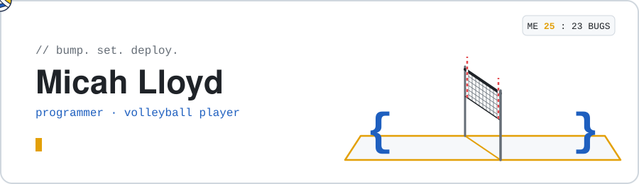

<picture>
  <source media="(prefers-reduced-motion: reduce) and (prefers-color-scheme: dark)" srcset="./assets/header-dark-static.svg">
  <source media="(prefers-reduced-motion: reduce)" srcset="./assets/header-light-static.svg">
  <source media="(prefers-color-scheme: dark)" srcset="./assets/header-dark.svg">
  
</picture>

<!-- A sentence or two about you goes here: what you build, and where to find you. -->

<picture>
  <source media="(prefers-color-scheme: dark)" srcset="https://raw.githubusercontent.com/Micah-L18/Micah-L18/output/commit-grid-dark.svg">
  
</picture>

<picture>
  <source media="(prefers-color-scheme: dark)" srcset="https://raw.githubusercontent.com/Micah-L18/Micah-L18/output/languages-dark.svg">
  
</picture>

